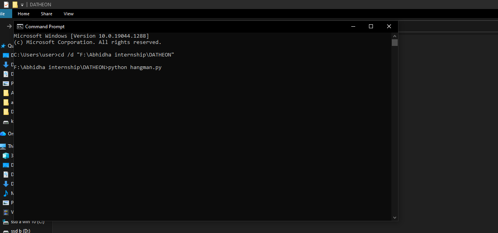
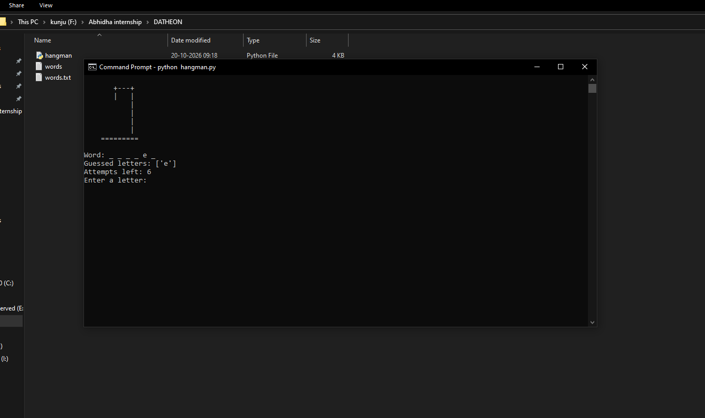
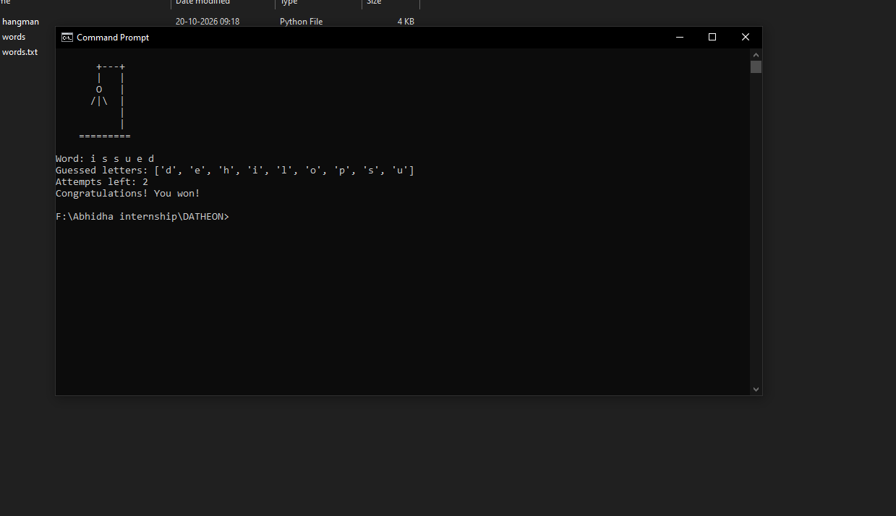

# Hangman Game

## Introduction

Hangman is a classic word-guessing game developed using Python. The computer randomly selects a secret word from a 
text file, and the player attempts to guess it one letter at a time.The player has a maximum of six incorrect guesses
to identify the hidden word. With each incorrect guess, a part of the hangman figure is drawn using ASCII art. The game 
tracks previously guessed letters and prevents duplicate guesses from reducing the remaining attempts. The player wins 
by guessing all the letters correctly before running out of attempts.This project demonstrates fundamental Python programming
concepts, including variables, loops, conditional statements, lists, user input handling, random word selection, text file handling,
and importing and using the `os` module to clear the terminal screen.

## Features

1. **Random Word Selection:** Randomly selects a secret word from the word list.

2. **Limited Attempts:** Allows a maximum of six incorrect guesses.

3. **ASCII Hangman Drawing:** Updates the Hangman drawing after each incorrect guess.

4. **Correctly Guessed Letters:** Displays correctly guessed letters in their respective positions in the secret word.

5. **Guessed Letter Tracking:** Keeps track of previously guessed letters.

6. **Duplicate Guess Prevention:** Prevents repeated guesses from reducing the remaining attempts.

7. **Win or Loss Messages:** Displays a winning message when the word is guessed correctly or a losing message when all attempts are used.

 
## Technologies Used

1. ** Programming Language: ** Python
2. ** Code Editor: ** Visual Studio Code (VS Code)

## Python Modules Used

- `random` – To randomly select a word from the word list.
- `os` – To clear the terminal screen between turns, keeping the game display clean and interactive.

## Programming Concepts Applied

Variables and data types 
Lists 
File handling 
Random Module
Functions 
Loops 
Conditional statements
User input handling
Input validation
String manipulation
Duplicate input prevention
Game state tracking
Terminal screen management

## How to Run

1. Install Python.
2. Open the project folder in a terminal.
3. Run `python hangman.py`.

## Algorithm

1. **Start the program.**

2. Open `words.txt` and read the words into a list.

3. Remove empty lines and convert all words to lowercase.

4. If the word list is empty, display an error message and stop the program.

5. Randomly select a secret word from the word list.

6. Initialize the list of guessed letters, set the number of wrong guesses to zero, and set the maximum attempts to six.

7. Display the Hangman drawing, the hidden word, previously guessed letters, and remaining attempts.

8. Ask the player to enter a letter.

9. Validate the input. If it is not a single alphabetic character, display an error message and ask again without deducting an attempt.

10. Check whether the letter has already been guessed. If so, display a message and ask again.

11. Add the new letter to the list of guessed letters.

12. If the letter is in the secret word, display a correct-guess message. Otherwise, display a wrong-guess message and increase the wrong-guess count by one.

13. Check whether all letters in the secret word have been guessed.

14. If all letters have been guessed, display the completed word and a winning message, then end the game.

15. If the player has made six incorrect guesses, display the final Hangman drawing, the losing message, and the secret word, then end the game.

16. Otherwise, ask the player to press Enter and continue from Step 7.

17. End the program.

## Improvements Made

1.During the development of this project, I referred to learning resources to improve my code, 
understand Python concepts, and make the game more user-friendly.

2.Improved file handling: Initially, I opened the word-list file using open() and closed it manually at the end of the 
program. I later switched to with open(), which automatically closes the file after use and makes file handling safer
and cleaner.

3.Word-list processing: I learned to use lower() and strip() together with list comprehension and if conditions
to convert words to lowercase, remove unnecessary whitespace, and ignore empty lines while processing the word 
list.

4.Empty-file validation: I added a check to detect when the word list contains no valid words and raise
a ValueError instead of allowing the game to proceed without a secret word.

5.Improved terminal display: I used the os module and os.system() to clear the terminal screen after each turn,
reducing clutter and making the game easier to follow.

6.Game progress tracking: I added the display of previously guessed letters and remaining attempts,
helping players keep track of their progress throughout the game.

7.Hangman visual experience: I created seven stages of ASCII art that update according to the number of incorrect guesses,
making the game feel more like a traditional Hangman game.

8.Input validation and duplicate prevention: I added checks to reject invalid inputs and prevent previously 
guessed letters from reducing the remaining attempts.

These improvements helped me strengthen my understanding of Python file handling, string methods, list comprehension, conditional
statements, exception handling, and terminal operations. They also helped me create a cleaner, more interactive, and user-friendly
Hangman game.

## Learning Resources and Development Approach

1. **YouTube Tutorials:** Referred to YouTube tutorials to understand Python concepts and learn different approaches to implementing the Hangman game.

2. **AI Tools:** Used AI tools to clarify coding doubts, understand errors, and explore ways to improve the implementation.

3. **Code Structuring:** Organized the program into functions, such as `game()` and `display_game()`, to separate the main game logic from the display functionality and improve readability.

4. **Practice and Improvement:** Applied the concepts I learned, tested the program, and refined the code to improve its functionality and user experience.

## Screenshots

### Starting the Game

### Game Output

### Another Game State

