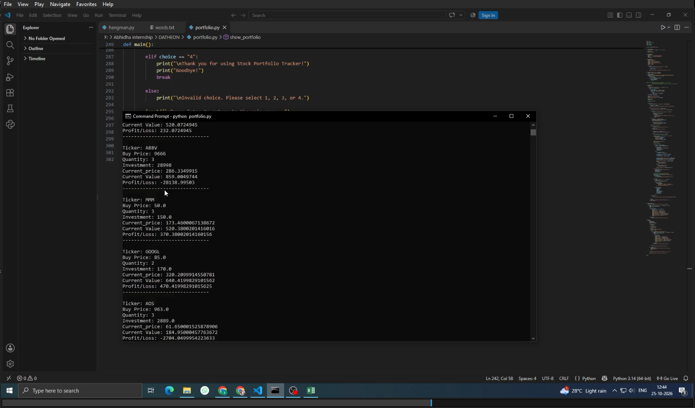

# Task 2: Stock Portfolio Tracker

## Project Overview

The Stock Portfolio Tracker is a Python-based command-line application developed as part of the Dath(e)on Python Programming Internship. It allows users to record stock purchases, view their portfolio information, and review transaction history.

## Features

- Add stock purchase transactions
- Generate unique customer IDs
- Validate stock tickers using a company dataset
- Calculate total investment based on purchase price and quantity
- Retrieve recent stock market data using Yahoo Finance
- Calculate current portfolio value and profit or loss
- Store transaction details in CSV format
- View portfolio details and transaction history

## Technologies Used

- Python 3
- CSV module
- Random module
- OS module
- yfinance library

## Project Structure

```text
Task_2_Stock_Portfolio_Tracker/
├── portfolio.py
├── README.md
└── company_dataset.csv
```

## Requirements

- Python 3 installed
- Internet connection for retrieving market data
- The yfinance library

## Installation

Install the required library:

```bash
python -m pip install yfinance
```

## How to Run

1. Download or clone this repository.
2. Open the `Task_2_Stock_Portfolio_Tracker` folder in your terminal.
3. Ensure `company_dataset.csv` is present.
4. Run the application:

```bash
python portfolio.py
```

5. Select an option from the main menu to add a transaction, view a portfolio, view transaction history, or exit.

## Data Storage

The application stores customer IDs in `details.txt` and transaction records in `portfolio_summary.csv`. These files are generated or updated during program execution.

Do not commit real customer IDs or personal financial records. Use sample data for demonstrations.

## Limitations

- Market data availability depends on Yahoo Finance and the internet connection.
- The retrieved closing price may not represent the live market price.
- Profit/loss calculations do not account for taxes, fees, or dividends.
- Portfolio consolidation across multiple purchases is not yet implemented.

## Learning Outcomes

This project demonstrates Python functions, loops, conditional statements, dictionaries, exception handling, CSV file operations, random ID generation, and the use of an external Python library.

## Disclaimer

This project is for educational purposes only and does not provide financial or investment advice.


## Output Screenshots

### 1. Portfolio Tracker - Output 1


### 2. Portfolio Tracker - Output 2


### 3. Portfolio Tracker - Output 3


### 4. Portfolio Tracker - Output 4


